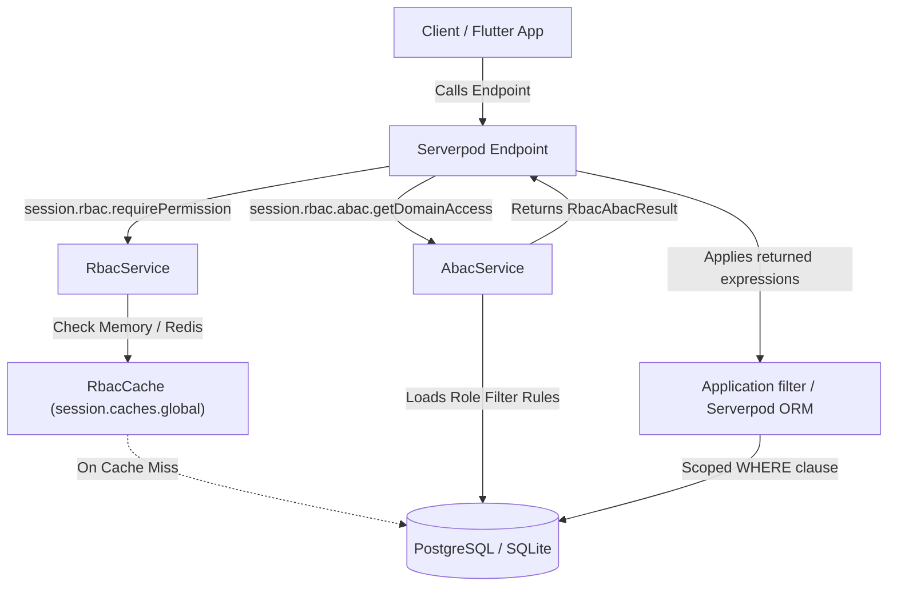

# Serverpod RBAC & ABAC Developer Guide

A production-grade, highly efficient Role-Based & Attribute-Based Access Control (RBAC & ABAC) framework for Serverpod 4.0.4.

This module provides named permissions, reusable roles, role-based Odoo-style row-filter domains, high-performance Redis caching, and single-query eager fetching with modern Serverpod ORM relations. Domain expressions are stored and returned as JSON; applications install and apply a query-filtering library separately.

For a sequential, beginner-friendly explanation of the source files and functions, see the [Technical Guide](./TECHNICAL_GUIDE.md).

---

## Table of Contents

1. [Architectural Overview](#1-architectural-overview)
2. [Packages and Project Layout](#2-packages-and-project-layout)
3. [Installation & Serverpod Module Integration](#3-installation--serverpod-module-integration)
4. [Data Model & Modern ORM Relations](#4-data-model--modern-orm-relations)
5. [Core Concepts: RBAC & ABAC](#5-core-concepts-rbac--abac)
   - [Strict Role-Based Security](#strict-role-based-security)
   - [Odoo-Style Row Domains (`hasDomains`)](#odoo-style-row-domains-hasdomains)
   - [Superuser Privileges](#superuser-privileges)
   - [Wildcard Permissions](#wildcard-permissions)
6. [Single & Bulk Administrative Operations](#6-single--bulk-administrative-operations)
   - [Permission Management](#permission-management)
   - [Role Management](#role-management)
   - [Role-Permission Assignments](#role-permission-assignments)
   - [User-Role Assignments](#user-role-assignments)
7. [Enforcing Authorization in Server Endpoints (`session.rbac`)](#7-enforcing-authorization-in-server-endpoints-sessionrbac)
8. [Applying Odoo-Style Domains with `serverpod_filters_server`](#8-applying-odoo-style-domains-with-serverpod_filters_server)
9. [Client Endpoints API Reference](#9-client-endpoints-api-reference)
   - [`RbacEndpoint` (Self-Service Inspection)](#rbacendpoint-self-service-inspection)
   - [`RbacAdminEndpoint` (System Administration)](#rbacadminendpoint-system-administration)
10. [High-Performance Distributed Caching](#10-high-performance-distributed-caching)
11. [Complete Real-World End-to-End Examples](#11-complete-real-world-end-to-end-examples)
    - [Example A: Row-Level Filtering for Patient Records](#example-a-row-level-filtering-for-patient-records)
    - [Example B: Administrative Endpoint Seeding via Bulk APIs](#example-b-administrative-endpoint-seeding-via-bulk-apis)
12. [Testing & Migrations](#12-testing--migrations)

---

## 1. Architectural Overview

Traditional authorization systems often struggle with either being too rigid (static RBAC without tenant awareness) or overly complex and slow (heavy ABAC engines with complex policy interpreters).

`serverpod_rbac` provides a clean, hybrid approach:
- **Strict RBAC for capabilities**: Users are assigned roles, and roles hold permissions. No direct, fragile user-permission overrides.
- **ABAC Domains for row filtering**: Roles can carry Odoo-style filter expressions scoped to a resource/model, such as `[['ownerId', '=', 42]]`.
- **Decoupled ABAC Service**: `serverpod_rbac` stores and returns filter-expression strings through `session.rbac.abac`. It does not depend on or execute `serverpod_filters_server`; applications install that package separately and apply the expressions to their own queries.
- **Zero-Boilerplate Standard Caching**: Utilizes Serverpod's distributed Redis cache (`session.caches.global`) with request-level memoization and O(1) generation-based cache busting.
- **Modern Serverpod ORM**: Built using Serverpod 4.0.4 bidirectional relations (`relation(name=...)`) enabling single-query eager fetching (`include`) for entire user authorization graphs.
- **Bulk & Single Operations**: High-throughput endpoints powered by `insert()` and `insertRow()`. No external seeder scripts required.



---

## 2. Packages and Project Layout

The workspace is organized into two companion packages:

| Package | Purpose |
|---|---|
| `serverpod_rbac_server` | Core server module: database models, `RbacService`, `AbacService`, `RbacCache`, `Session.rbac` extension, and endpoints. |
| `serverpod_rbac_client` | Client-side SDK: generated models, serialization protocols, and typed endpoint callers for Flutter or Dart clients. |

Both packages are versioned together and target **Serverpod 4.0.4** and **Dart SDK `^3.12.2`**.

---

## 3. Installation & Serverpod Module Integration

### Step 1: Add Dependencies

In your Serverpod server's `pubspec.yaml`:

```yaml
dependencies:
  serverpod: 4.0.4
  serverpod_rbac_server: ^1.0.0
```

In your Flutter app or client project's `pubspec.yaml`:

```yaml
dependencies:
  serverpod_client: 4.0.4
  serverpod_rbac_client: ^1.0.0
```

If your server will compile stored domains into ORM queries, add `serverpod_filters_server` separately to the server's dependencies. It is not a dependency of `serverpod_rbac_server`.

### Step 2: Register Module in `config/generator.yaml`

In your server project's `config/generator.yaml`:

```yaml
modules:
  serverpod_rbac:
    nickname: rbac
```

### Step 3: Run Generation and Apply Migrations

Run Serverpod generation from your server project directory:

```powershell
serverpod generate
```

Create and apply the database migrations:

```powershell
serverpod create-migration
dart run bin/main.dart --apply-migrations
```

---

## 4. Data Model & Modern ORM Relations

The data model uses Serverpod 4.x bidirectional object relations, enabling full cascade deletes and single-query relational loading.

### `RbacPermission`
Represents a granular permission.

```yaml
class: RbacPermission
table: serverpod_rbac_permission
fields:
  resource: String
  codename: String
  name: String
  description: String?
  roles: List<RbacRolePermission>?, relation(name=permission_roles)
  createdAt: DateTime, default=now

indexes:
  serverpod_rbac_perm_res_code_idx:
    fields: resource, codename
    unique: true
```

### `RbacRole`
A named group of permissions. Can optionally grant superuser status.

```yaml
class: RbacRole
table: serverpod_rbac_role
fields:
  name: String, unique
  description: String?
  isSuperuser: bool, default=false
  isSystemRole: bool, default=false
  permissions: List<RbacRolePermission>?, relation(name=role_permissions)
  userRoles: List<RbacUserRole>?, relation(name=role_user_roles)
  domainRules: List<RbacDomainRule>?, relation(name=role_domain_rules)
  createdAt: DateTime, default=now
```

### `RbacRolePermission`
Bidirectional join table connecting roles to permissions.

```yaml
class: RbacRolePermission
table: serverpod_rbac_role_permission
fields:
  role: RbacRole?, relation(name=role_permissions, onDelete=Cascade)
  permission: RbacPermission?, relation(name=permission_roles, onDelete=Cascade)
  createdAt: DateTime, default=now

indexes:
  serverpod_rbac_role_perm_idx:
    fields: roleId, permissionId
    unique: true
```

### `RbacUserRole`
Assigns a role to a user. Row-filter domains are stored separately on `RbacDomainRule`.

```yaml
class: RbacUserRole
table: serverpod_rbac_user_role
fields:
  userIdentifier: String
  role: RbacRole?, relation(name=role_user_roles, onDelete=Cascade)
  createdAt: DateTime, default=now

indexes:
  serverpod_rbac_user_role_user_role_idx:
    fields: userIdentifier, roleId
    unique: true
  serverpod_rbac_user_role_user_idx:
    fields: userIdentifier
```

### `RbacDomainRule`
Stores an Odoo-style JSON filter expression for a role and resource/model, optionally scoped to one permission such as `invoice.create`. A null permission preserves legacy behavior and applies that rule to every permission on the resource. The expression is returned as supplied (apart from trimming outer whitespace) for the application to pass to its query-filtering library.

```yaml
class: RbacDomainRule
table: serverpod_rbac_domain_rule
fields:
  role: RbacRole?, relation(name=role_domain_rules, onDelete=Cascade)
  resource: String
  permission: String?
  filterExpression: String
  description: String?
  createdAt: DateTime, default=now

indexes:
  serverpod_rbac_domain_rule_role_resource_idx:
    fields: roleId, resource, permission
  serverpod_rbac_domain_rule_resource_idx:
    fields: resource
```

---

## 5. Core Concepts: RBAC & ABAC

### Strict Role-Based Security
Permissions cannot be assigned directly to individual users. This guarantees:
- Predictable auditability and access reviews.
- Zero orphaned permission overrides when users change jobs or departments.
- Easy bulk management of permissions by simply modifying role definitions.

### Odoo-Style Row Domains (`hasDomains`)
Domain rules are filter expressions attached to a role, a resource/model, and optionally a permission, for example:

```json
[["state", "=", "published"], ["ownerId", "=", 42]]
```

The expression is stored as supplied (apart from trimming outer whitespace) and returned as a JSON string. This package does not parse the expression, know the target model's fields, or apply it to a query. Install a compatible filtering library such as `serverpod_filters_server` in the application and pass the returned expressions to it.

Create a permission-specific rule by passing `permission` to `addDomainRule`:

```dart
await AbacService.instance.addDomainRule(
  session,
  roleName: 'invoice_creator',
  resource: 'invoice',
  permission: 'invoice.create',
  filterExpression: '[["createdBy", "=", 42]]',
);
```

`getDomainAccess(permission: 'invoice.create', resource: 'invoice')` includes rules matching that normalized permission, matching permission wildcards such as `invoice.*`, and legacy rules with no permission. An exact rule for `invoice.create` does not apply to `invoice.read`.

`getDomainAccess` reports:
- `isAllowed`: the user has the requested permission, or is a superuser.
- `hasDomains`: at least one matching role supplies a filter for the resource.
- `filterExpressions`: distinct stored expressions matching that permission and resource, including matching wildcard and legacy resource-wide rules. Multiple matching role rules are alternative grants; combine them with OR in the application.
- `isUnrestricted`: a matching permission is granted by a role without a rule for that resource, or by a superuser. In that case no domain filter should be applied.

Always check `isAllowed` before querying. An empty `filterExpressions` list alone does not distinguish denied access from unrestricted access. Pass a resource and permission matching the query; role-wide inspection without either can include expressions for different models/actions and is not suitable for direct query filtering.

### Combining rules from multiple roles

The effective access is the union of each matching role's grant:

- Multiple expressions for the same role/permission/resource are OR alternatives.
- If an individual expression contains multiple criteria, the filter package's implicit-AND syntax means every criterion in that expression must match.
- Expressions returned across roles are also OR-combined. For example, north-branch OR south-branch grants access to either branch.
- If any role grants the permission without a matching domain rule for that resource and permission, access is unrestricted. A superuser is also unrestricted.

This is an allow-list/union model; it does not intersect restrictions from separate roles. If the application requires intersection semantics, use a single policy expression representing that intersection rather than OR-combining role expressions.

### Superuser Privileges
A user is automatically treated as a superuser if:
1. The authenticated session has Serverpod's `Scope.admin`.
2. The user is assigned any role with `isSuperuser: true`.
3. A custom `customSuperuserResolver` callback returns `true`.

Superusers bypass all permission checks and are granted unrestricted domain access (`isUnrestricted = true`, `hasDomains = false`).

### Wildcard Permissions
Permission codenames support wildcards:
- `*.*`: Grants full access across all resources.
- `article.*`: Grants all actions within the `article` resource (e.g. `article.view`, `article.edit`, `article.delete`).

---

## 6. Single & Bulk Administrative Operations

All operations are available on both `RbacService.instance` (server-side) and `RbacAdminEndpoint` (client RPC). Every operation supports single (`insertRow()`, `deleteRow()`) and high-throughput bulk (`insert()`, `delete()`) variants.

### Permission Management

```dart
final rbac = RbacService.instance;

// Single insert (insertRow)
final perm = await rbac.createPermission(
  session,
  resource: 'invoice',
  codename: 'approve',
  name: 'Approve Invoices',
  description: 'Can approve outgoing vendor invoices',
);

// Bulk insert (insert)
final bulkPerms = await rbac.createPermissions(session, [
  RbacPermission(resource: 'invoice', codename: 'create', name: 'Create Invoice'),
  RbacPermission(resource: 'invoice', codename: 'pay', name: 'Pay Invoice'),
  RbacPermission(resource: 'invoice', codename: 'cancel', name: 'Cancel Invoice'),
]);

// List permissions (optionally by resource)
final invoicePerms = await rbac.listPermissions(session, resource: 'invoice');

// Bulk delete
await rbac.deletePermissions(session, [perm.id!]);
```

### Role Management

```dart
// Single role creation (insertRow)
final editorRole = await rbac.createRole(
  session,
  name: 'editor',
  description: 'Can edit content',
);

// Bulk role creation (insert)
final newRoles = await rbac.createRoles(session, [
  RbacRole(name: 'author', description: 'Can draft content'),
  RbacRole(name: 'auditor', description: 'Read-only financial auditor'),
]);

// Single delete
await rbac.deleteRole(session, 'author');

// Bulk delete
await rbac.deleteRoles(session, ['auditor']);
```

### Role-Permission Assignments

```dart
// Bulk assign permissions to a role
await rbac.assignPermissionsToRole(
  session,
  roleName: 'editor',
  permissions: ['article.view', 'article.edit', 'article.publish'],
);

// Remove specific permissions
await rbac.removePermissionsFromRole(
  session,
  roleName: 'editor',
  permissions: ['article.publish'],
);

// Fetch permissions assigned to role
final perms = await rbac.getRolePermissions(session, 'editor');
```

### User-Role Assignments

```dart
await rbac.assignRoleToUser(
  session,
  userIdentifier: 'user-001',
  roleName: 'editor',
);

// Bulk assign multiple roles to a user
await rbac.assignRolesToUser(
  session,
  userIdentifier: 'user-003',
  roleNames: ['editor', 'reviewer'],
);

// Bulk assign a single role to multiple users
await rbac.assignRoleToUsers(
  session,
  userIdentifiers: ['user-004', 'user-005', 'user-006'],
  roleName: 'auditor',
);

// Remove role assignment
await rbac.removeRoleFromUser(
  session,
  userIdentifier: 'user-004',
  roleName: 'auditor',
);
```

Attach row-level filter domains to a role separately with `AbacService.addDomainRule` (or `RbacAdminEndpoint.addDomainRule`), specifying the resource/model each expression applies to.

---

## 7. Enforcing Authorization in Server Endpoints (`session.rbac`)

Use the `session.rbac` extension on `Session` to perform fast, expressive authorization checks.

### Basic Checks

```dart
class ArticleEndpoint extends Endpoint {
  @override
  bool get requireLogin => true;

  Future<void> publishArticle(Session session, int id) async {
    // Throws RbacException (reason: permissionDenied) if not allowed
    await session.rbac.requirePermission('article.publish');

    // Business logic
  }

  Future<bool> canDelete(Session session) async {
    return session.rbac.hasPermission('article.delete');
  }
}
```

### Composite Checks (AND / OR)

```dart
// Require ALL permissions (AND)
await session.rbac.requireAllPermissions(['report.view', 'report.export']);

// Require AT LEAST ONE permission (OR)
await session.rbac.requireAnyPermission(['post.edit', 'post.moderate']);

// Require ALL roles
await session.rbac.requireAllRoles(['billing_admin', 'auditor']);

// Require AT LEAST ONE role
await session.rbac.requireAnyRole(['supervisor', 'manager', 'director']);
```

---

## 8. Applying Odoo-Style Domains with `serverpod_filters_server`

`serverpod_rbac_server` returns domain JSON strings and intentionally does not depend on a filtering package. Add `serverpod_filters_server` separately to the application server when you want to compile those expressions into Serverpod ORM filters. The filter package supports its documented list/prefix syntax; it is not a full implementation of every Odoo domain feature.

```dart
import 'package:serverpod/serverpod.dart';
import 'package:serverpod_filters_server/serverpod_filters_server.dart';
import '../generated/protocol.dart';

class OrderEndpoint extends Endpoint {
  @override
  bool get requireLogin => true;

  Future<List<Order>> listOrders(Session session) async {
    final access = await session.rbac.abac.getDomainAccess(
      'order.read',
      resource: 'order',
    );
    if (!access.isAllowed) {
      throw RbacException(
        message: 'Permission denied: required "order.read"',
        reason: RbacExceptionReason.permissionDenied,
        requiredPermission: 'order.read',
        userIdentifier: session.authenticated?.userIdentifier,
      );
    }

    if (!access.hasDomains) {
      return Order.db.find(session, orderBy: (table) => table.createdAt);
    }

    const allowedFields = {'status', 'ownerId', 'createdAt'};
    return Order.db.find(
      session,
      where: (table) {
        final policyExpressions = access.filterExpressions.map(
          (domain) => ServerpodFilters.toWhere(
            domain,
            table,
            allowedFields: allowedFields,
            strict: true,
          ),
        );
        return policyExpressions.reduce((left, right) => left | right);
      },
      orderBy: (table) => table.createdAt,
    );
  }
}
```

Each stored expression is an alternative grant, so multiple expressions must be OR-combined. If you also accept a caller-supplied filter, validate it with a field allowlist and AND it with the policy expression; never let a client filter replace or weaken the RBAC domain. For a denied result, do not query. For an unrestricted result, omit the policy predicate.

---

## 9. Client Endpoints API Reference

### `RbacEndpoint` (Self-Service Inspection)
Accessible to any authenticated user to inspect their own permissions, roles, and row-filter rules:

| Method | Return Type | Description |
|---|---|---|
| `isSuperuser()` | `Future<bool>` | Checks if current user has superuser privileges. |
| `getMyPermissions()` | `Future<RbacUserPermissionsInfo>` | Returns the user's roles and permissions. |
| `getMyRoles()` | `Future<List<String>>` | Returns assigned role names. |
| `hasDomains(String permission, {String? resource})` | `Future<bool>` | Checks whether the user has filters for this permission and resource. |
| `getMyDomainFilters(String permission, {String? resource})` | `Future<List<String>>` | Returns the matching stored filter-expression strings. |
| `getMyDomainAccess(String permission, {String? resource})` | `Future<RbacAbacResult>` | Returns permission and domain evaluation for the resource. |
| `getMyAllDomainFilters({String? resource})` | `Future<List<String>>` | Returns stored expressions across the user's roles. |
| `hasPermission(String permission)` | `Future<bool>` | Checks if the user has a permission. |
| `hasAllPermissions(List<String> permissions)` | `Future<bool>` | Checks if user has all listed permissions. |
| `hasAnyPermission(List<String> permissions)` | `Future<bool>` | Checks if user has any listed permission. |
| `hasRole(String role)` | `Future<bool>` | Checks if user has a role. |
| `hasAllRoles(List<String> roles)` | `Future<bool>` | Checks if user has all listed roles. |
| `hasAnyRole(List<String> roles)` | `Future<bool>` | Checks if user has any listed role. |
| `requirePermission(String permission)` | `Future<void>` | Enforces permission or throws `RbacException`. |
| `requireRole(String role)` | `Future<void>` | Enforces role or throws `RbacException`. |
| `requireSuperuser()` | `Future<void>` | Enforces superuser status or throws `RbacException`. |

### `RbacAdminEndpoint` (System Administration)
Requires `Scope.admin`, `isSuperuser`, or permission `'rbac.manage'`:

| Category | Method | Description |
|---|---|---|
| **Permissions** | `createPermission(...)` | Single permission creation (`insertRow`). |
| | `createPermissions(...)` | Bulk permission creation (`insert`). |
| | `listPermissions({String? resource})` | Lists permissions. |
| | `deletePermission(int permissionId)` | Deletes a single permission (`deleteRow`). |
| | `deletePermissions(List<int> permissionIds)` | Bulk deletes permissions. |
| **Roles** | `createRole(...)` | Single role creation (`insertRow`). |
| | `createRoles(...)` | Bulk role creation (`insert`). |
| | `listRoles()` | Lists all roles. |
| | `deleteRole(String name)` | Deletes a single role (`deleteRow`). |
| | `deleteRoles(List<String> names)` | Bulk deletes roles. |
| **Role Permissions** | `assignPermissionsToRole(...)` | Bulk assigns permissions to a role. |
| | `removePermissionsFromRole(...)` | Bulk removes permissions from a role. |
| | `getRolePermissions(String roleName)` | Lists permissions assigned to a role. |
| **User Roles** | `assignRoleToUser(...)` | Assigns a role to a user. |
| | `assignRolesToUser(...)` | Bulk assigns multiple roles to a user. |
| | `assignRoleToUsers(...)` | Bulk assigns a role to multiple users. |
| | `removeRoleFromUser(...)` | Removes a role assignment from a user. |
| | `removeRolesFromUser(...)` | Bulk removes roles from a user. |
| | `listUserRoles(...)` | Queries user-role records with optional filters. |
| | `getUserRoles(String userIdentifier)` | Lists roles assigned to user. |
| | `getUserPermissionsInfo(String userIdentifier)` | Fetches permissions snapshot for any user. |
| **ABAC Rules** | `addDomainRule(...)` / `addDomainRules(...)` | Adds Odoo-style row-filter expressions to a role. |
| | `removeDomainRule(...)` / `clearDomainRules(...)` | Removes stored domain rules. |
| | `listDomainRules(...)` | Lists rules for a role, optionally filtered by resource. |
| | `getUserDomainFilters(...)` | Returns expressions for a user's permission and resource. |
| | `getUserDomainAccess(...)` | Returns permission and domain evaluation for a user. |
| | `getAllUserDomainFilters(...)` | Lists expressions across a user's roles. |

---

## 10. High-Performance Distributed Caching

`serverpod_rbac` uses Serverpod's distributed cache (`session.caches.global`) when Redis is configured. Within a request, it also memoizes authorization lookups in memory.

### How Caching Works

1. **Request-Level Memoization (`Expando`)**:
   Repeated checks in the same `Session` can reuse cached permission summaries and domain decisions without another database lookup. Once the global generation is loaded, repeated checks also avoid extra cache-generation lookups.
2. **Distributed Redis Cache (`session.caches.global`)**:
   Stores serialized `RbacUserPermissionsInfo` snapshots for five minutes and permission/resource-scoped `RbacAbacResult` decisions for one minute, allowing reuse across server instances.
3. **Generation-Based Invalidation**:
   - `invalidateUser(session, userId)`: Invalidates that user's cached permission summary and advances their domain-cache generation when role assignments change.
   - `invalidateAll(session)`: Advances a global generation when roles, permissions, or domain rules change, making old cache keys unreachable across instances.
4. **No Redis configured**:
   Global cache access may be unavailable; cache failures fall back to resolving authorization from the database, while request-local memoization still applies. The TTL bounds stale results if a cache write or invalidation cannot be completed.

---

## 11. Complete Real-World End-to-End Examples

### Example A: Row-Level Filtering for Patient Records

Attach a JSON filter to the clinician role. The resource is the model key used by authorization checks, not a tenant/domain name.

```dart
import 'package:serverpod/serverpod.dart';
import 'package:serverpod_filters_server/serverpod_filters_server.dart';
import 'package:serverpod_rbac_server/serverpod_rbac_server.dart';
import '../generated/protocol.dart';

await AbacService.instance.addDomainRule(
  session,
  roleName: 'clinician',
  resource: 'patient',
  filterExpression:
      '[["branchCode", "in", ["branch-a", "branch-b"]]]',
);

class PatientEndpoint extends Endpoint {
  @override
  bool get requireLogin => true;

  /// Fetches patient records visible to the current clinician.
  Future<List<PatientRecord>> getPatients(Session session) async {
    final access = await session.rbac.abac.getDomainAccess(
      'patient.read',
      resource: 'patient',
    );
    if (!access.isAllowed) {
      throw RbacException(
        message: 'Permission denied: required "patient.read"',
        reason: RbacExceptionReason.permissionDenied,
        requiredPermission: 'patient.read',
        userIdentifier: session.authenticated?.userIdentifier,
      );
    }

    if (!access.hasDomains) {
      return PatientRecord.db.find(session, orderBy: (t) => t.lastName);
    }

    const allowedFields = {'branchCode'};
    return PatientRecord.db.find(
      session,
      where: (table) => access.filterExpressions
          .map(
            (domain) => ServerpodFilters.toWhere(
              domain,
              table,
              allowedFields: allowedFields,
              strict: true,
            ),
          )
          .reduce((left, right) => left | right),
      orderBy: (table) => table.lastName,
    );
  }
}
```

### Example B: Administrative Endpoint Seeding via Bulk APIs

Instead of writing fragile database seeders, configure your application's initial roles and permissions directly through high-performance bulk operations:

```dart
import 'package:serverpod/serverpod.dart';
import 'package:serverpod_rbac_server/serverpod_rbac_server.dart';

class SystemSetupService {
  static Future<void> initializeDefaultRbac(Session session) async {
    final rbac = RbacService.instance;

    // 1. Bulk create permissions
    await rbac.createPermissions(session, [
      RbacPermission(resource: 'article', codename: 'create', name: 'Create Articles'),
      RbacPermission(resource: 'article', codename: 'edit', name: 'Edit Articles'),
      RbacPermission(resource: 'article', codename: 'publish', name: 'Publish Articles'),
      RbacPermission(resource: 'article', codename: 'delete', name: 'Delete Articles'),
      RbacPermission(resource: 'billing', codename: 'view', name: 'View Billing'),
      RbacPermission(resource: 'billing', codename: 'manage', name: 'Manage Billing'),
    ]);

    // 2. Bulk create roles
    await rbac.createRoles(session, [
      RbacRole(name: 'writer', description: 'Can draft articles'),
      RbacRole(name: 'editor', description: 'Can draft and publish articles'),
      RbacRole(name: 'admin', description: 'Organization administrator'),
      RbacRole(name: 'superadmin', description: 'Global superuser', isSuperuser: true),
    ]);

    // 3. Assign permissions to roles
    await rbac.assignPermissionsToRole(
      session,
      roleName: 'writer',
      permissions: ['article.create', 'article.edit'],
    );

    await rbac.assignPermissionsToRole(
      session,
      roleName: 'editor',
      permissions: ['article.create', 'article.edit', 'article.publish'],
    );

    await rbac.assignPermissionsToRole(
      session,
      roleName: 'admin',
      permissions: [
        'article.*',
        'billing.*',
      ],
    );

    // 4. Assign initial admin user
    await rbac.assignRoleToUser(
      session,
      userIdentifier: 'root-admin-id',
      roleName: 'superadmin',
    );
  }
}
```

---

## 12. Testing & Migrations

### Running Integration Tests
The test suite validates both core engine mechanisms and endpoint contracts:

```powershell
cd serverpod_rbac_server
dart test
```

### Creating Migrations After Model Changes
If you extend models in `lib/src/models`:

```powershell
# 1. Regenerate Serverpod code
serverpod generate

# 2. Create migration
serverpod create-migration

# 3. Apply migration to test database
dart test
```
